# 急停标定台

给 **ROG 魔导士 ACE HFX**（Falchion Ace HFX）磁轴键盘用户做的《无畏契约》急停测试网站。它不会替你改键盘，而是先测出你手指平时按多深、抬多高、A/D 切换时有没有重叠，再把这些习惯翻译成 Armoury Crate 里的具体数字：触发点、快速触发的下压/上抬、顶部/底部死区、DKS 各层的行程位置。

全程大约 15 分钟。做完你会得到一张表，照着抄进 Armoury Crate 就行。

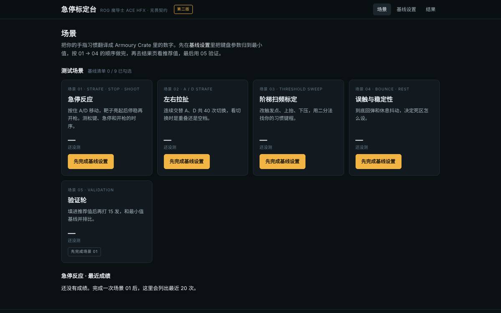

---

## 目录

- [准备工作](#准备工作)
- [第 0 步 · 下载并打开](#第-0-步--下载并打开)
- [第 1 步 · 在 Armoury Crate 里把参数归到最小值](#第-1-步--在-armoury-crate-里把参数归到最小值)
- [第 2 步 · 填灵敏度，做键盘自检](#第-2-步--填灵敏度做键盘自检)
- [第 3 步 · 场景 01 急停反应](#第-3-步--场景-01-急停反应)
- [第 4 步 · 场景 02 左右拉扯](#第-4-步--场景-02-左右拉扯)
- [第 5 步 · 场景 03 阶梯扫频标定](#第-5-步--场景-03-阶梯扫频标定)
- [第 6 步 · 场景 04 误触与稳定性](#第-6-步--场景-04-误触与稳定性)
- [第 7 步 · 看结果，把参数抄进 Armoury Crate](#第-7-步--看结果把参数抄进-armoury-crate)
- [第 8 步 · 场景 05 验证轮](#第-8-步--场景-05-验证轮)
- [常见问题](#常见问题)
- [给开发者](#给开发者)
- [合规与免责声明](#合规与免责声明)
- [许可证](#许可证)

---

## 准备工作

你需要：

- 一把 ROG 魔导士 ACE HFX 键盘，连在 Windows 电脑上，装好 **Armoury Crate**。
- 一个电脑浏览器（Chrome 或 Edge 最好）。手机和平板不行，测试需要实体键盘和鼠标。
- 能上网。网页本身是本地文件，但 3D 场景用的 Three.js 是从公共 CDN 加载的。
- 15 分钟不被打扰的时间。中途可以退出，每个场景的结果会单独保存在浏览器里。

网页只记录浏览器里的按键事件，不读取、不修改键盘设置，不上传任何数据。

---

## 第 0 步 · 下载并打开

**方法一：下载 ZIP（最简单）**

1. 在本页面右上角点绿色的 **Code** 按钮，选 **Download ZIP**。
2. 解压到任意文件夹。
3. 双击解压出来的 `index.html`，它会在默认浏览器里打开。

**方法二：用 git**

```
git clone https://github.com/KingHenry666/counterstrafe-calibrator.git
```

然后打开文件夹里的 `index.html`。

打开后你会看到上面那张首页。五张卡片就是五个场景，按 01 → 04 的顺序做，最后用 05 验证。现在它们还不能点，因为要先做第 1 步。

---

## 第 1 步 · 在 Armoury Crate 里把参数归到最小值

**为什么要归零：** 网页读不到磁轴的模拟行程，只能看到"按下"和"松开"两个事件。把键盘参数调到最灵敏，手指一动键盘就报事件，这时测到的才是你真实的手，而不是被参数裁剪过的结果。抖动、到底回弹也都会暴露出来，这些正是后面决定死区和上抬值的依据。

点顶部导航的 **基线设置**，左边是一张 9 项清单，右边是灵敏度和自检。

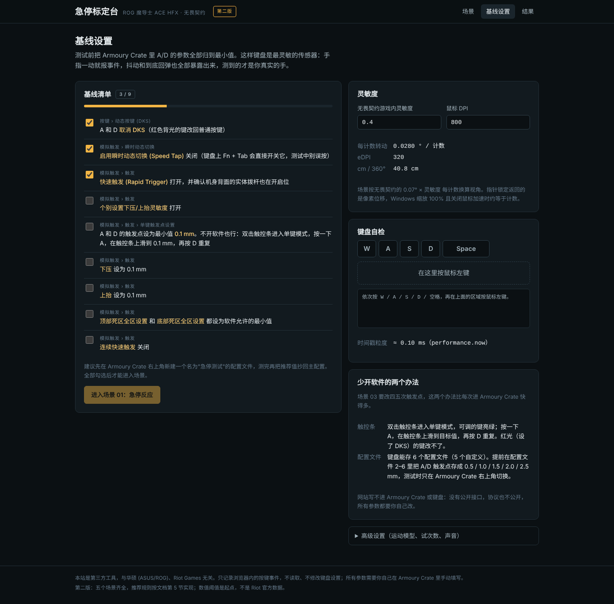

建议先在 Armoury Crate 右上角新建一个配置文件（比如叫"急停测试"），所有改动都在这个配置文件里做，测完再把推荐值抄回你平时用的那个。

### 1a · 模拟触发 › 触发 页面

打开 Armoury Crate，左侧选 **设备**，顶部选 **模拟触发**，再选 **触发** 子页。

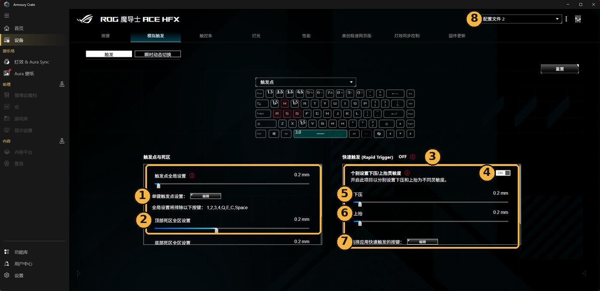

| 标记 | 字段 | 改成 |
| --- | --- | --- |
| ⑧ | 配置文件下拉 | 新建或切到测试用的配置文件 |
| ① | 单键触发点设置 › 编辑 | 把 **A 和 D** 的触发点设为 **0.1 mm** |
| ② | 顶部死区全区设置 | 拉到软件允许的最小值 |
| ③ | 快速触发 (Rapid Trigger) | **开**。同时翻过键盘，确认机身背面右上角的实体拨杆也在开启位 |
| ④ | 个别设置下压/上抬灵敏度 | **ON** |
| ⑤ | 下压 | **0.1 mm** |
| ⑥ | 上抬 | **0.1 mm** |
| ⑦ | 选择应用快速触发的按键 › 编辑 | 确认包含 W / A / S / D |

往下滚动还有两项：

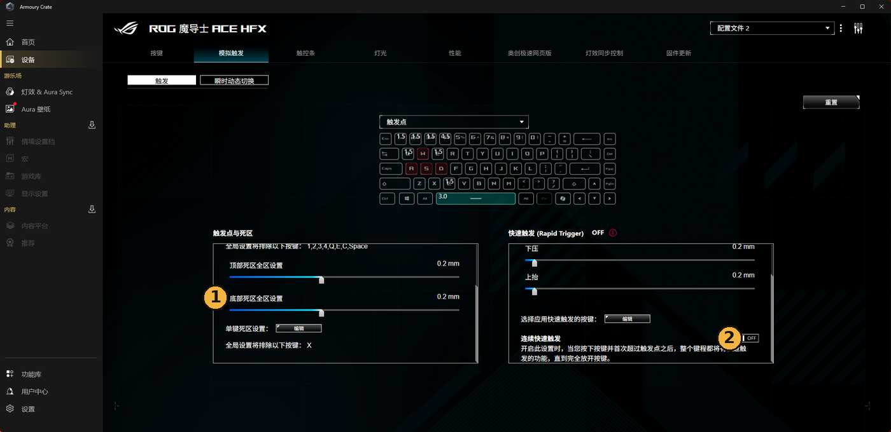

| 标记 | 字段 | 改成 |
| --- | --- | --- |
| ① | 底部死区全区设置 | 拉到软件允许的最小值 |
| ② | 连续快速触发 | **OFF** |

> 不想开软件改触发点也行：**双击键盘触控条**进入单键模式，可以调的键会亮绿色；按一下 A，在触控条上滑到 0.1 mm，再按 D 重复。设了 DKS 的键会亮红色，改不了，所以先做 1c。

### 1b · 模拟触发 › 瞬时动态切换 页面

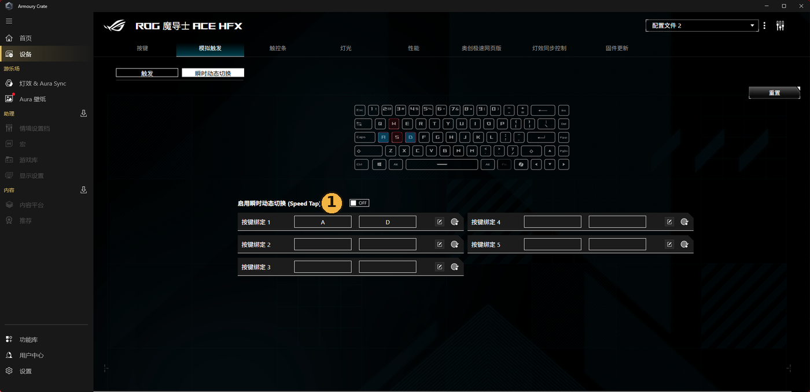

| 标记 | 字段 | 改成 |
| --- | --- | --- |
| ① | 启用瞬时动态切换 (Speed Tap) | **OFF** |

注意键盘上 **Fn + Tab** 会直接开关 Speed Tap，测试过程中别误按。

### 1c · 按键 页面，取消 A 和 D 的 DKS

如果你之前给 A 或 D 设过动态按键 (DKS)，它会改写按键事件，必须先取消。顶部选 **按键**，在键盘图上点 A（设了 DKS 的键有红色边框），右边的功能下拉改回普通按键；D 同样。

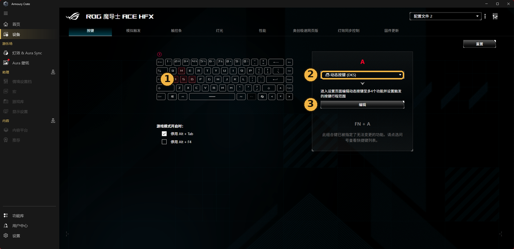

| 标记 | 说明 |
| --- | --- |
| ① | 在键盘图上点选要改的键 |
| ② | 功能下拉，如果显示"动态按键 (DKS)"就改回默认 |
| ③ | 编辑按钮，第 7 步填 DKS 方案时会用到 |

### 1d · 回到网页，勾完清单

每做好一项就在网页上勾一项。9 项全勾完，进度条满，"进入场景 01" 按钮才会亮。勾选状态会记住，下次打开不用重勾。

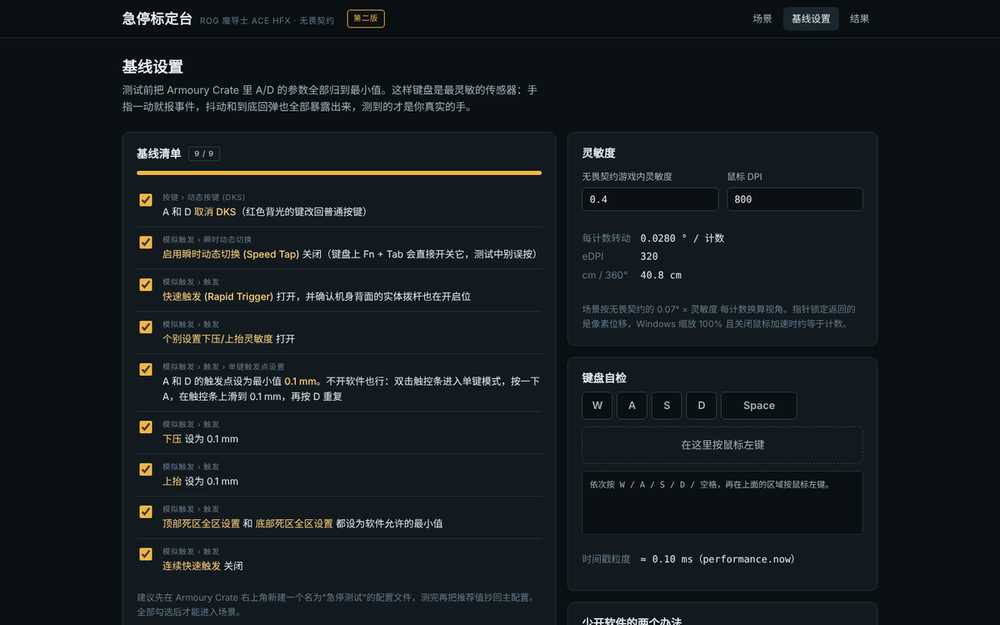

---

## 第 2 步 · 填灵敏度，做键盘自检

还是在基线设置页的右边。

1. **灵敏度**：填你《无畏契约》游戏内的灵敏度和鼠标 DPI。网页按游戏的 0.07° × 灵敏度 每计数换算视角，这样 3D 场景里的瞄准手感和游戏一致。下面会顺带算出 eDPI 和 cm/360°。
2. **键盘自检**：依次按 W、A、S、D、空格，每个键亮一下表示网页收到了事件；再在虚线框里按一下鼠标左键。下面的小黑框会列出事件间隔，"时间戳粒度"是你这台电脑的计时精度，看一眼就行。
3. **高级设置**可以不碰。里面是运动模型参数、试次数和提示音开关。

然后回到首页，五张卡片都能点了。

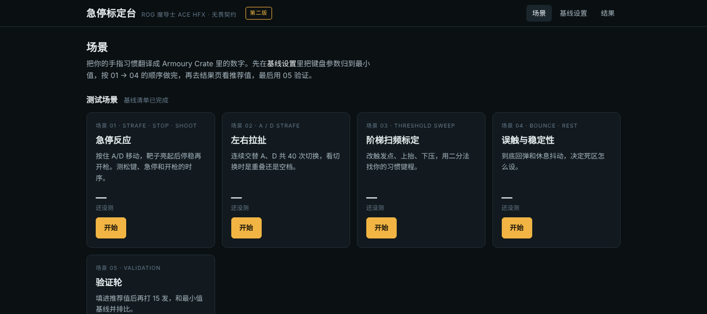

---

## 第 3 步 · 场景 01 急停反应

这是核心场景，测的是你松键、急停、开枪三件事的时序。

点首页第一张卡的 **开始**，先看到说明：

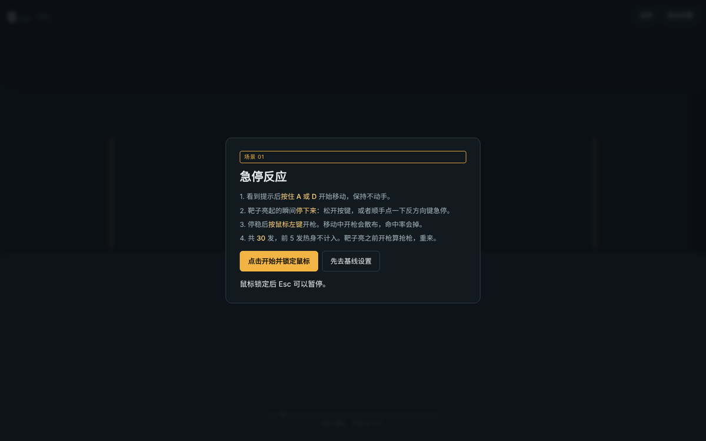

点 **点击开始并锁定鼠标**，鼠标会被锁进页面（和游戏里一样），按 Esc 可以暂停。

**每一发怎么打：**

1. 屏幕上方提示你按住 **A** 或 **D**，按住不放，角色会左右移动，底部的速度条涨到 100%。
2. 随机 0.8 到 2.5 秒后，前方的球形靶子亮成黄色，屏幕显示"停！开枪"。
3. **立刻停下**：松开按键，或者顺手点一下反方向键急停，两种都行，用你平时的习惯。
4. 速度条回到左边的停稳线以内后，**按鼠标左键**开枪。移动中开枪会有散布，容易打不中。

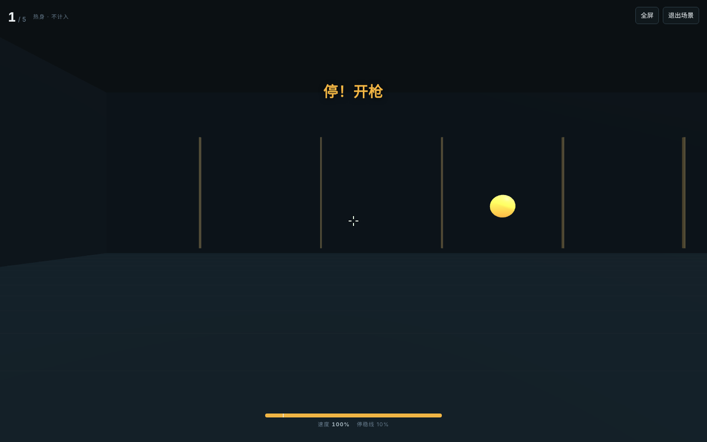

每一发之后屏幕中间会给一行读数：松键到开枪隔了多少毫秒、是停稳了还是移动中开枪、有没有急停、有没有命中。

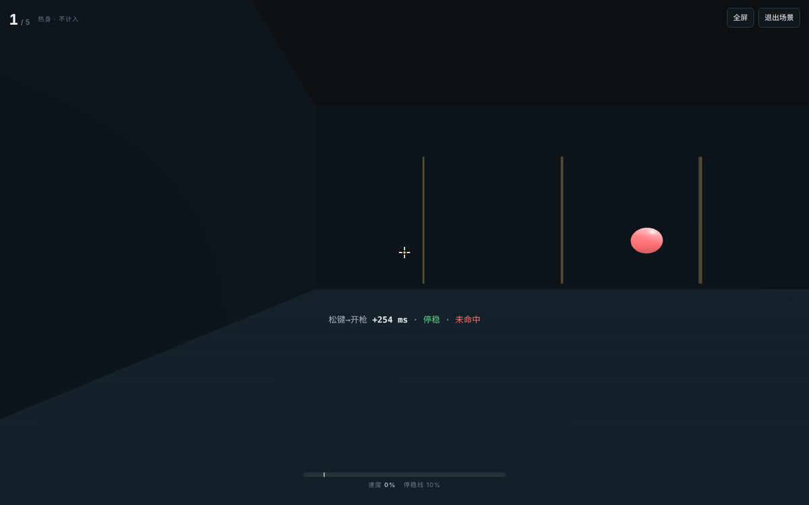

共 30 发，前 5 发是热身不计分。靶子还没亮就开枪算抢枪，这一发重来；亮了 2.5 秒还不开枪算超时，也重来。

打完会弹出成绩面板：分数（停稳率占 70%，命中率占 30%）、停稳率、命中率、松键到开枪的中位数等。点 **下一项：场景 02** 继续。

---

## 第 4 步 · 场景 02 左右拉扯

测 A/D 切换时两个键是**重叠**（下一个键按下时上一个还没松开，游戏里这段时间角色是不动的）还是有**空档**。

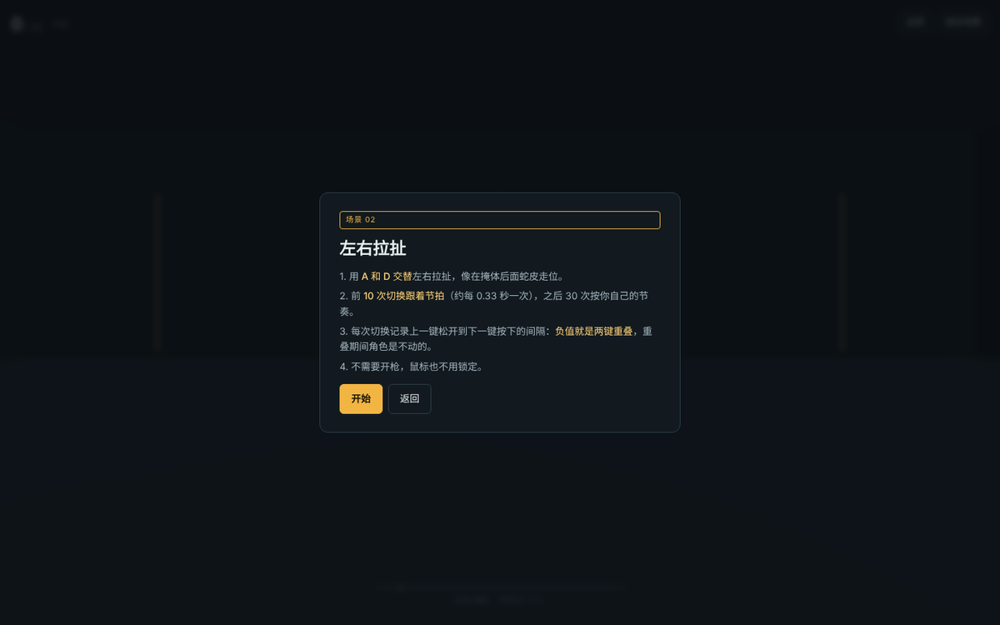

这个场景不锁鼠标，也不用开枪。点开始后：

1. 前 10 次切换**跟着节拍**，大约每 0.33 秒一拍，听到"哒"就换方向。
2. 之后 30 次按你自己平时拉扯的节奏。
3. 每次切换屏幕中间会显示"空档 +xx ms"或红色的"重叠"。

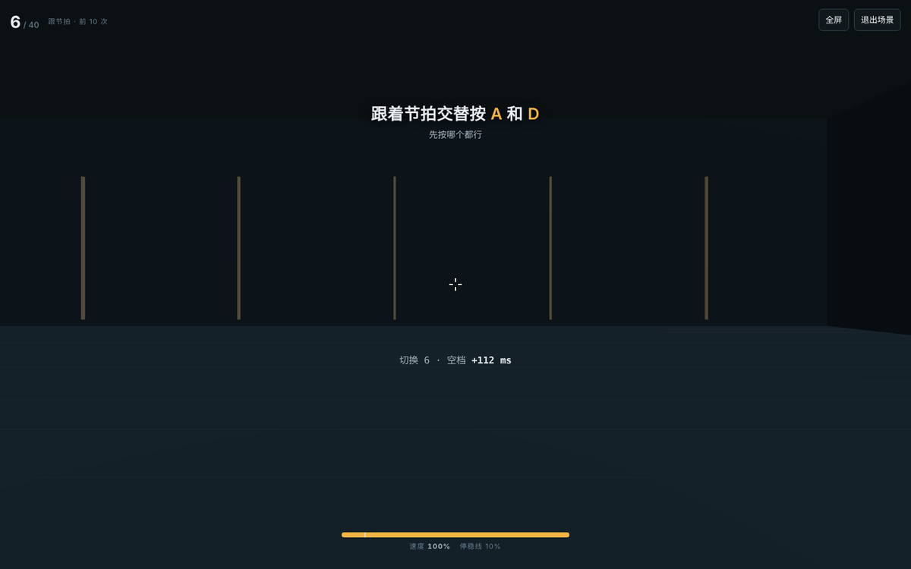

40 次切换后自动结束，给出重叠率、空档中位数、切换间隔和节奏稳定性。

---

## 第 5 步 · 场景 03 阶梯扫频标定

这是唯一需要你中途改键盘设置的场景，也是找出"习惯键程"的关键。

**原理一句话：** 把触发点一档一档调深，你用平时的力度按；键盘还能注册，说明你按得比这个深；哪一档开始漏，那一档就是你平时按压的深度。

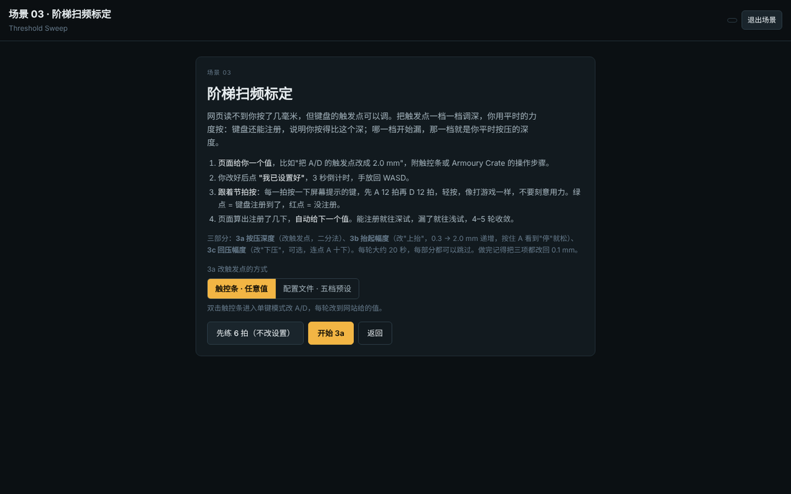

开始前选一下 3a 改触发点的方式：

- **触控条 · 任意值**（推荐）：每轮用触控条把 A/D 改到网页给的值。
- **配置文件 · 五档预设**：提前在配置文件 2 到 6 里把 A/D 触发点分别存成 0.5 / 1.0 / 1.5 / 2.0 / 2.5 mm，测试时只在 Armoury Crate 右上角切换配置文件。

第一次做建议先点 **先练 6 拍（不改设置）**，感受一下节拍。

### 每一轮的四步

**第一步，网页给你一个值。** 比如"把 A 和 D 的触发点改成 2.0 mm"，卡片上写着怎么改。

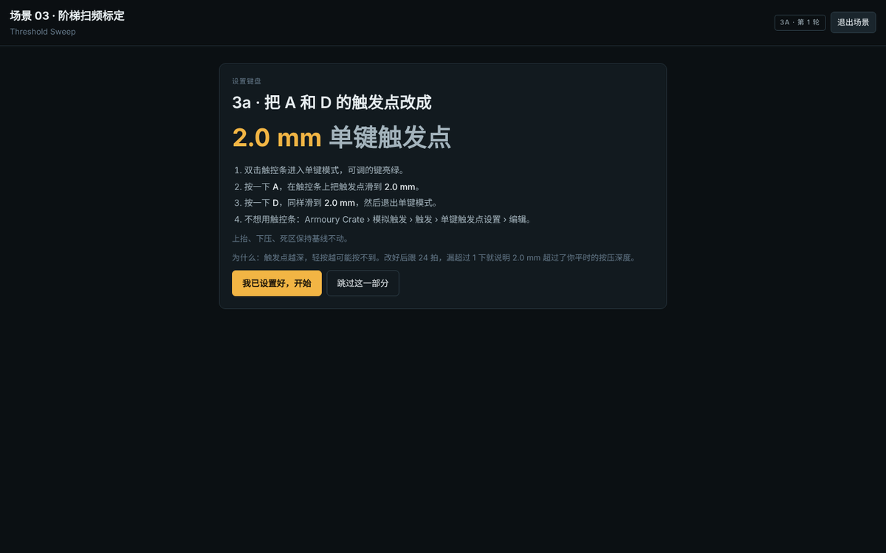

**第二步，改好后点"我已设置好，开始"。** 3 秒倒计时，把手放回 WASD。

**第三步，跟着节拍按。** 先 A 12 拍，再 D 12 拍，每一拍按一下亮起的那个键。轻按，像打游戏一样，**不要因为知道在测深度就刻意用力**。绿点表示键盘注册到了，红点表示没注册到。

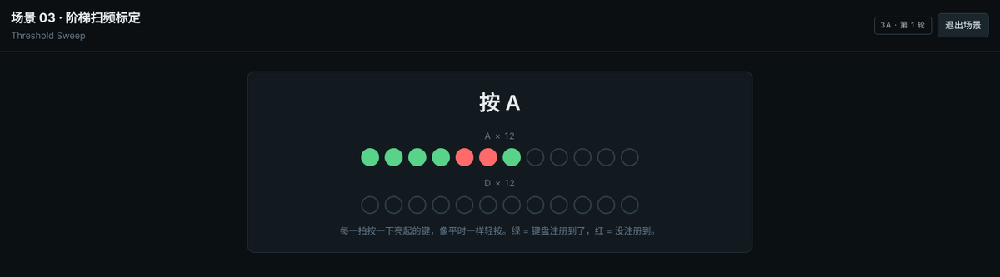

**第四步，网页自动给下一个值。** 漏不超过 1 次算通过，就往更深试；漏多了就往浅试。4 到 5 轮收敛到 0.2 到 0.3 mm 的区间。

### 3b 和 3c

3a 做完会进入 3b，改的是**上抬**，从 0.3 mm 开始往上：

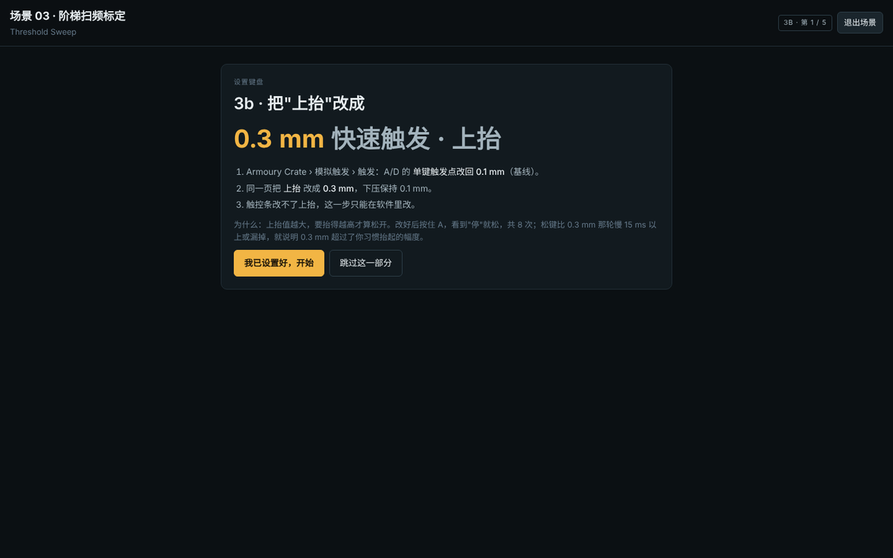

任务变成"按住 A，看到'停'就松开"，共 8 次。上抬值大到你抬不到那么高时，松键会明显变慢或漏掉，那一档就是你习惯抬起幅度的上限。

3c 改的是**下压**，可选，任务是快速连点 A 十下看计数。不想做就点"跳过这一部分"。

**做完之后，把 A/D 触发点、上抬、下压全部改回 0.1 mm**，再做场景 04。结束页会提醒你。

---

## 第 6 步 · 场景 04 误触与稳定性

两个小测试，决定死区怎么设。

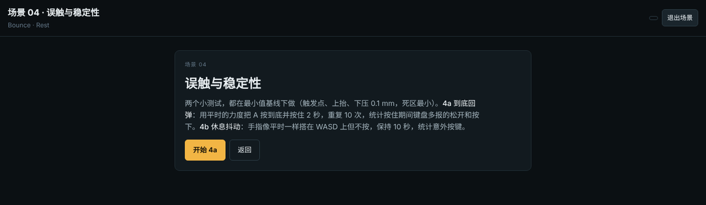

**4a 到底回弹：** 用平时的力度把 A 按到底并按住，圆环走满 2 秒再松开，重复 10 次。如果按住期间键盘多报了"松开 + 按下"，屏幕会闪一下"回弹 ×1"。回弹多说明你到底后手指有微小抖动，底部死区和上抬要加大。

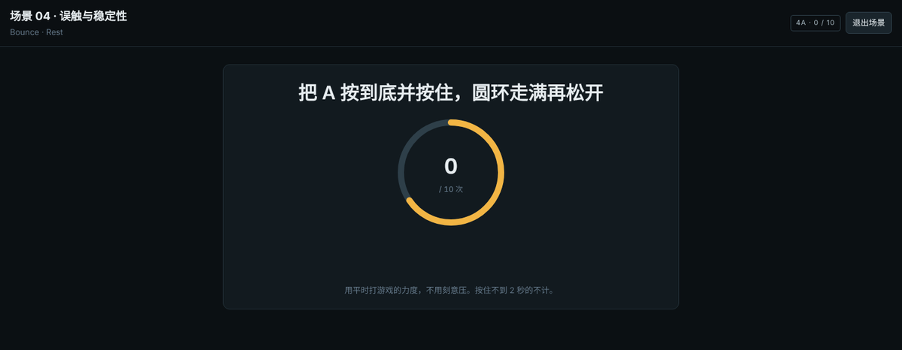

**4b 休息抖动：** 3 秒倒计时后，手指像平时一样搭在 WASD 上**但不按**，保持 10 秒。意外按下的键会被记下来。误触多说明顶部死区和触发点下限要加大。

做完直接点 **查看结果和推荐值**。

---

## 第 7 步 · 看结果，把参数抄进 Armoury Crate

顶部导航点 **结果**。

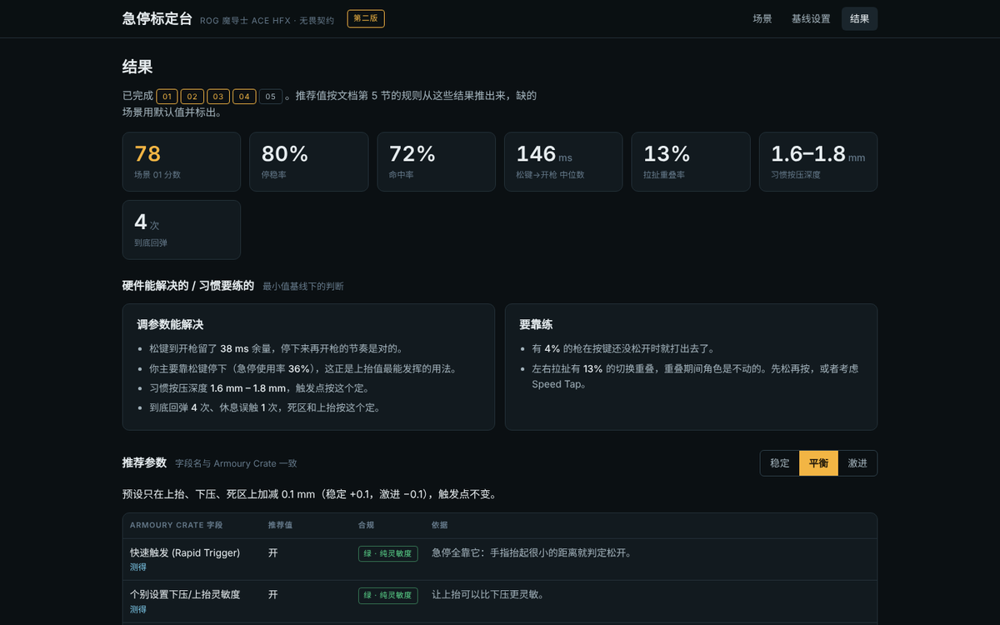

从上往下：

1. **指标卡**：场景 01 的分数、停稳率、命中率，加上后面几个场景的关键数字。
2. **硬件能解决的 / 习惯要练的**：左边是调参数能改善的，右边是调参数也没用、只能练的。比如在最小值基线下你开枪仍然比停稳早，那是节奏问题，再怎么调上抬也不会变好。
3. **推荐参数表**：每一行对应 Armoury Crate 里的一个字段，字段名和软件里一模一样。

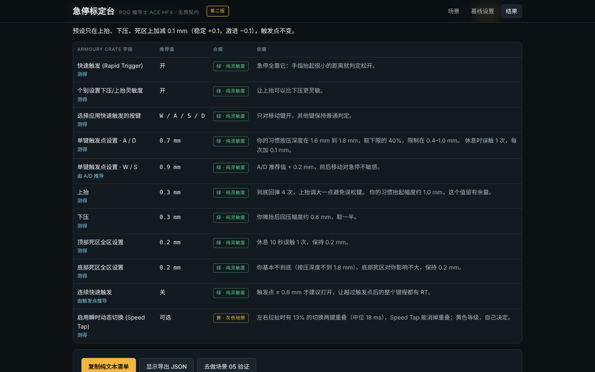

表格每行有三样东西：

- **推荐值**：直接抄。
- **状态**："测得"表示这个值是从你的测试算出来的；"默认值，待场景 03"之类表示那个场景你还没做，先用默认值。
- **合规**：绿色是纯灵敏度设置，随便用；黄色是灰色地带（目前允许，Riot 以后可能收紧）；橙色是一次输入产生两个动作的方案，风险自负，默认折叠。

右上角的 **稳定 / 平衡 / 激进** 预设只在上抬、下压、死区上加减 0.1 mm，不确定就用平衡。

**抄进 Armoury Crate：** 点 **复制纯文本清单**，然后回到第 1 步那两张截图的位置，逐项填。先切到你平时用的配置文件再填。

### DKS 方案

再往下是两个 DKS 方案，用和 Armoury Crate 里一样的 4 列 × 4 槽网格画出来：

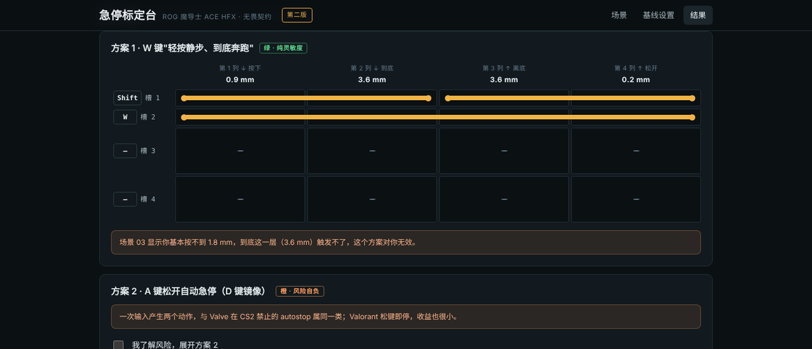

- **方案 1（绿色）**：W 键"轻按静步、到底奔跑"。如果场景 03 显示你基本按不到底，网页会告诉你这个方案对你无效。
- **方案 2（橙色）**：A 键松开自动急停。默认折叠，勾"我了解风险"才展开。无畏契约松键即停，这个方案收益很小，不建议用。

要填方案 1，在 Armoury Crate 里：**按键** › 点 W › 功能下拉选 **动态按键 (DKS)** › **编辑**，进入这个页面：

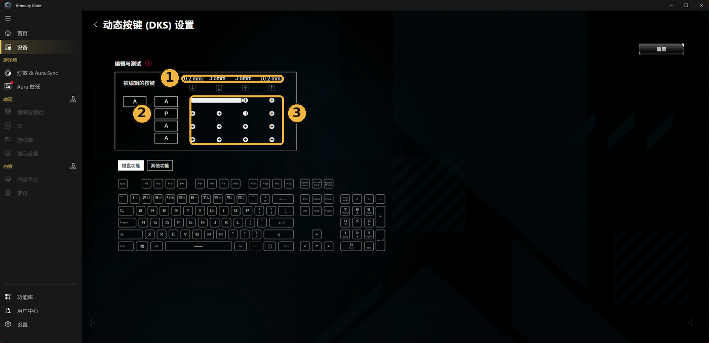

| 标记 | 说明 |
| --- | --- |
| ① | 四列的深度，第 1 列和第 4 列可以改，填结果页网格表头的数字 |
| ② | 四个动作槽，每个槽点一下选一个键 |
| ③ | 每个槽在四列里的格子：圆点是"点按"，横条是"从这一列按住到那一列"，照结果页的网格画 |

---

## 第 8 步 · 场景 05 验证轮

推荐值填好之后，回到首页点场景 05。它会先把要填的值再列一遍，勾"我已经把这些值填进 Armoury Crate 了"才能开始。

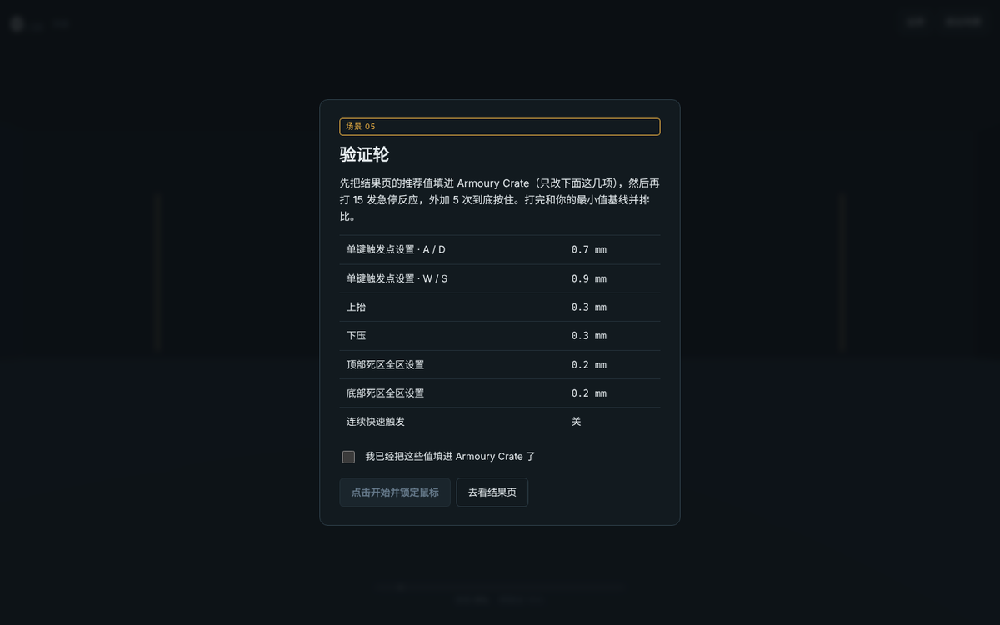

内容是 3 发热身 + 15 发急停反应 + 5 次到底按住。打完和你在最小值基线下的成绩并排比：停稳率不能下降，到底回弹不能变多，"松键到开枪"缩短不超过 10 ms（上抬调大必然让松开判定变晚，这一项限制它晚多少）。

- **通过**：推荐值成立，收工。
- **没通过**：结果页自动把上抬和死区各回退 0.1 mm，按新值再验一次，最多两次。两次都不过的话用"稳定"预设，并回头看看是不是节奏问题。

---

## 常见问题

**打开网页只有空白或 3D 场景不显示。**
网页需要联网加载 Three.js。检查网络，刷新。如果弹出"3D 场景没有加载出来"，就是这个原因。

**点开始后鼠标没有被锁住。**
有些浏览器窗口（比如嵌在别的程序里）不允许锁定鼠标，网页会在 0.7 秒后自动改成跟随光标的视角，结果里会标注"本次未能锁定鼠标"。换 Chrome 或 Edge 直接打开通常就好了。

**测试中途切出去了。**
窗口失去焦点会自动暂停，当前这一发作废，点继续会重做这一发。

**场景 03 的节拍太快跟不上 / 太慢。**
节拍是 0.6 秒一拍。如果经常漏拍，先用"先练 6 拍"练几次；如果觉得慢，正常按就行，网页只看那一拍有没有注册，不看你快慢。

**我按不到 3.6 mm，DKS 方案 1 怎么办。**
那它对你确实没用，网页会标出来。DKS 的"到底"是固定在 3.6 mm 的，按不到就触发不了。

**结果数据存在哪，怎么清。**
存在浏览器的 localStorage 里，不上传。结果页最底下有"清空全部结果"（要点两次）。换浏览器或清缓存后数据会没。

**毫秒数能和别人比吗。**
不能。浏览器的时间戳精度、显示器延迟每台机器都不一样，所有毫秒数只在你自己这台电脑上做前后比较。

---

## 给开发者

纯前端单文件，没有后端，没有构建依赖。

```
python3 build.py            # 把 src/ 拼成 index.html
node tests/rules.test.js    # 对运动模型、拉扯指标、二分法、推荐规则跑合成输入
```

`src/` 里的文件按拼接顺序命名：

| 文件 | 内容 |
| --- | --- |
| `head.html` | 标题、字体、CSS 变量和全部样式 |
| `lab.css` | 场景 03 / 04 的实验室视图样式 |
| `markup.html` | 页面结构 |
| `a-core.js` | 配置、`RULES`、存储、运动模型、指标、扫频二分法、推荐规则 |
| `b-routing-scene.js` | 路由、首页、基线设置、Three.js 场景、HUD |
| `c-scenarios-3d.js` | 场景 01 / 05（急停反应、验证轮）和 02（左右拉扯） |
| `d-scenarios-lab.js` | 场景 03（扫频）和 04（误触） |
| `e-results-input.js` | 结果页、全局输入、启动 |

推荐规则的阈值都在 `a-core.js` 的 `RULES` 对象里，运动模型默认值在 `DEFAULTS`，DKS 到底位置是 `DKS_BOTTOM_MM`。运动模型是一个简化的加速/减速模型（默认加速 120 ms、减速 100 ms、急停时减速减半），不是 Riot 的官方数据，可以在网页的高级设置里改。

浏览器拿不到磁轴的模拟行程，只有 keydown / keyup 时序，所以网站用两种办法反推：时序分析（最小值基线下的松键到开枪、A→D 切换空档或重叠、到底回弹）和阶梯扫频（让用户改触发点，看哪一档开始漏注册）。网站写不进 Armoury Crate 或键盘：没有公开接口，协议也不公开。

`docs/images/` 里的网站截图由 Playwright 生成，Armoury Crate 截图来自实机。

---

## 合规与免责声明

截至 2026 年 10 月，Valorant 未禁止硬件层面的 SOCD / Snap Tap（VCT 2025 官方竞赛规则 2.3.5 允许），但属于 Riot 可能收紧的灰色地带；Valve 则在 CS2 官方服务器禁止了这类输入自动化。结果页给每项推荐标了合规等级，"松开自动急停"的 DKS 方案默认折叠。网页永远不会推荐任何在电脑上运行的脚本或宏。

本站是第三方工具，与华硕 (ASUS/ROG)、Riot Games 无关。只记录浏览器内的按键事件，不读取、不修改键盘设置；所有参数需要你自己在 Armoury Crate 里手动填写。

---

## 许可证

[MIT](LICENSE)。可以自由使用、修改和分发，保留版权声明即可。本仓库不包含 Three.js 的源码（运行时从 CDN 加载，Three.js 本身也是 MIT 许可）。
